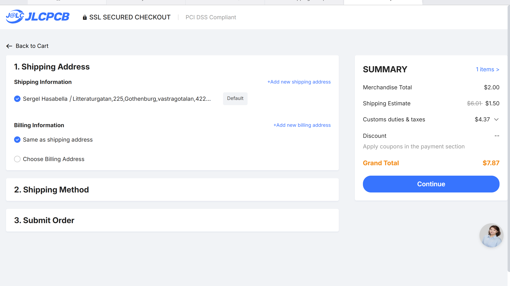
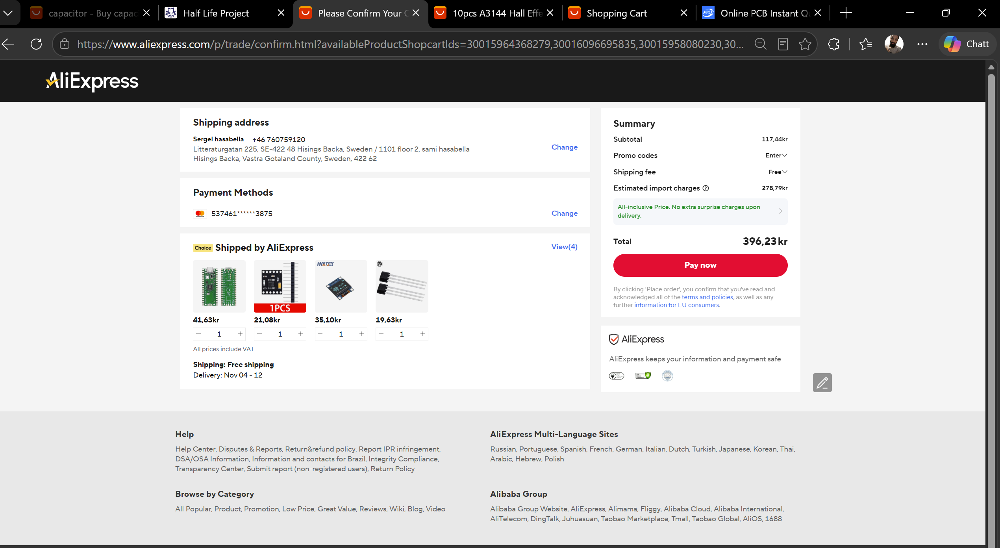

# FIDGIEZ Ti

A programmable fidget timer built around a Raspberry Pi Pico, SSD1306 OLED display, DRV8833 motor driver, Hall effect sensor, haptic feedback and a custom-designed PCB.

## Overview

FIDGIEZ Ti combines a mechanical fidget wheel with productivity features. The device can operate as a countdown timer, focus timer, and rotation tracker. A Hall effect sensor detects wheel movement, while a 128×64 OLED provides menus, status information, RPM statistics and timer data.

## Features

- Countdown timer mode
- Focus/Pomodoro mode
- RPM measurement
- Hall sensor rotation tracking
- SSD1306 OLED interface
- Status LED
- Audible buzzer notifications
- Haptic vibration feedback
- Custom PCB designed in KiCad
- Raspberry Pi Pico based controller

## Hardware

- Raspberry Pi Pico
- SSD1306 0.96" 128×64 OLED
- DRV8833 dual motor driver
- A3144 Hall effect sensor
- Main DC motor
- Haptic vibration motor
- Passive buzzer
- LED status indicator
- 2 tactile buttons

## Schematic


## PCB Layout


## 3D PCB Render


## BOM images


## Project Status

- [x] Requirements defined
- [x] Schematic completed
- [x] PCB designed
- [x] Custom DRV8833 footprint created
- [x] Gerbers generated
- [ ] PCB ordered
- [ ] Hardware assembly
- [ ] Firmware testing

## Repository Contents

```text
assets/         Images and renders
docs/           Documentation
*.*icad_pcb     PCB design
*.k*cad_sch     Schematic
BOM.csv     *   Bill of Materials
README.md    *  Project overview
