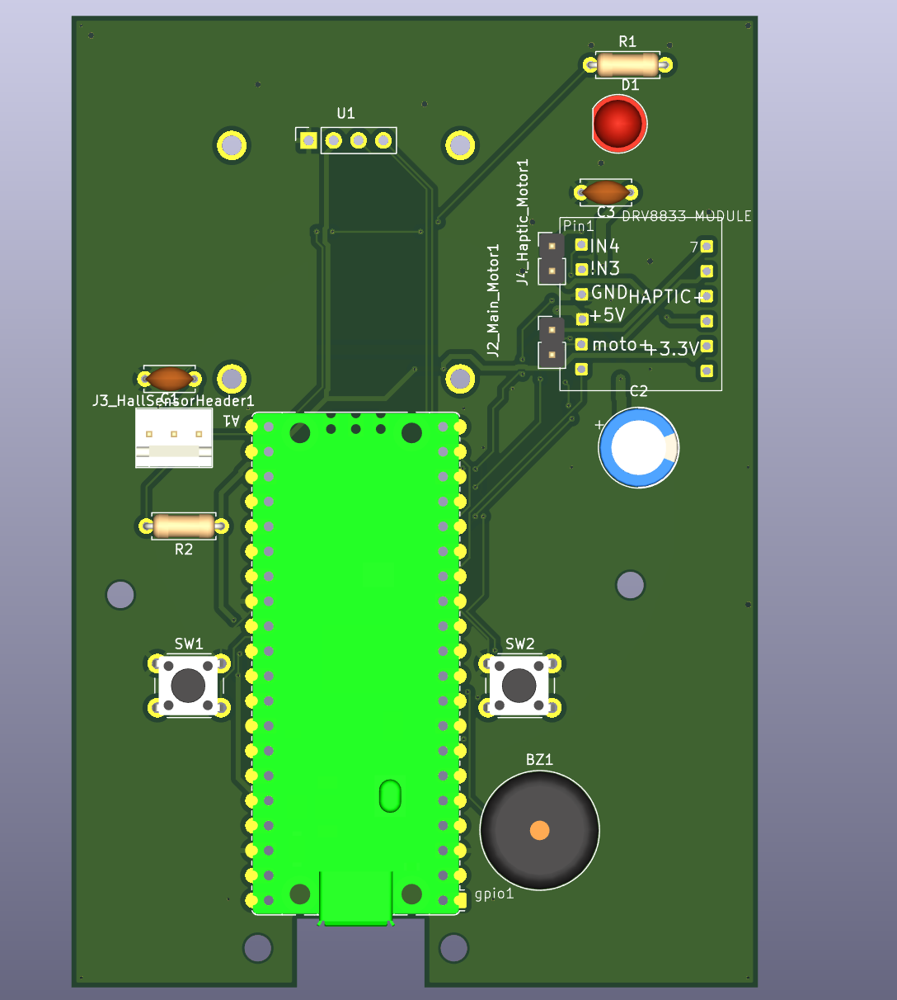

# Fidgize-Ti
A programmable fidget timer built around a Raspberry Pi Pico, SSD1306 OLED display, DRV8833 motor driver and Hall effect sensor.

# What it does

FIDGIEZ Ti combines a mechanical fidget wheel with productivity and focus-timer features. The device tracks wheel rotation using a Hall effect sensor and displays information on a 128×64 OLED display.

# Features:

Countdown timer mode
Focus/Pomodoro mode
Fidget statistics mode
RPM measurement
Hall sensor based rotation tracking
Haptic vibration feedback
Audible buzzer notifications
Status LED
Two-button user interface
Hardware

# The hardware includes:

Raspberry Pi Pico
SSD1306 0.96" 128×64 OLED
DRV8833 dual motor driver
A3144 Hall effect sensor
Main DC motor
Haptic vibration motor
Passive buzzer
Status LED
Two tactile push buttons
PCB

This project includes a custom KiCad PCB designed specifically for the FIDGIEZ Ti device.

Design files include:

![Schematic]/

![Manufacturing Gerber files]/aseets/FIDGIEZ Ti-pcb.zip)
)
Firmware

The firmware (incomplte) will run on the Raspberry Pi Pico and provide:

Timer functions
Focus sessions
RPM calculations
Motor control
OLED menu system
Persistent settings storage

Project Images

Add at least 2 images here.
